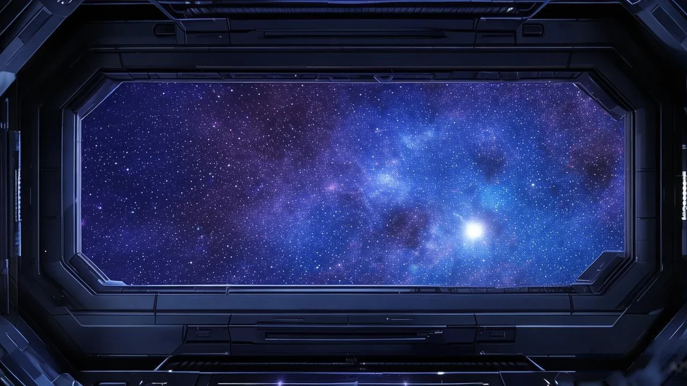

# Starship HUD · 星舰操作台

A Reasonix Studio theme: matte instrument panels, a nebula seen through the
forward window, and a cyan console accent. Dark-first; a cool light palette is
included so the pack loads in both schemes.



- **Theme id**: `plugin:starship-hud-kit:starship-hud`
- **Pack manifest**: `reasonix-plugin.json` (apiVersion `reasonix.io/plugin/v2`)
- **Theme schema**: `schemaVersion: 1` (studio authoring contract)
- **Package version**: 1.0.0

## What it changes

| Surface | Dark | Light |
| --- | --- | --- |
| Page | `#05090f` | `#dce7f0` |
| Panel | `#101b26` | `#eef5fa` |
| Border | `#1d5a7a` | `#9dbfd5` |
| Text | `#d7e5ef` | `#0a1822` |
| Accent | `#06b6d4` | `#0e7490` |
| Accent text | `#021a24` | `#ffffff` |

15 tokens per scheme: `bg bgSoft panel bgElev border borderSoft fg fgDim
fgFaint accent accentFg halo brand link codeBg`.

The backdrop is `starship-hud/background.webp` (1440×720). Studio locates it by
the conventional filename, so no `background.image` field is used. Home opacity
0.95, task opacity 0.6, overlay 0.55, focal point 0.6 / 0.5, safe area left.

One image serves both schemes: Studio has no per-scheme backdrop. The light
palette is therefore a cool fog blue rather than white, so the same nebula does
not fight the reading surface.

## Install

Local development copy:

```bash
reasonix plugin install ./starship-hud-kit --dry-run
reasonix plugin install ./starship-hud-kit --link --yes
reasonix plugin doctor starship-hud-kit
```

Restart Studio after an external CLI change, then open **Settings → Appearance
→ Browse themes** and pick **Starship HUD · 星舰操作台**.

The theme is read-only while contributed by a plugin: disable or remove the
package to stop showing it.

## Package layout

```text
starship-hud-kit/
  reasonix-plugin.json        # apiVersion reasonix.io/plugin/v2
  README.md
  LICENSE
  starship-hud/
    theme.json                # schemaVersion: 1
    background.webp           # 1440×720, 171 KiB
    preview.webp              # 1280×720 gallery card
```

## Compatibility and requirements

- Tested against Reasonix Studio 2.52.0 (theme contract `schemaVersion: 1`).
- No required tools, credentials, network access, or runtime sidecar. The pack
  is declarative: tokens plus one image.
- Platforms: Windows, macOS, Linux — the theme has no platform-specific code.
- Known incompatibility: the retired desktop app's Theme Pack V2 format
  (`schemaVersion: 2` with `baseStyle`, `recipes`, `taskBackground`) is **not**
  read by Studio. Such a pack is loaded and then dropped without a warning, so
  the theme never appears in Appearance. This package deliberately ships
  schemaVersion 1 only.

## Review evidence

Minimal input: install the package from the pinned commit, restart Studio, open
Settings → Appearance → Browse themes.

Expected result: one card named **Starship HUD · 星舰操作台** under the
non-official group; selecting it paints the dark palette above and shows the
nebula backdrop; switching to light mode uses the light palette.

Observed at submission time (2026-10-26, Reasonix Studio 2.52.0, Windows):

- Installed from a local folder through **Settings → Extensions → Install**. The
  install plan reported one theme contribution and no execution capability;
  Studio copied the package to `plugins/starship-hud-kit/` and recorded it in
  `plugin-packages.json` as enabled.
- The gallery listed the pack and served
  `GET /themes/plugin:starship-hud-kit:starship-hud/preview` with 200.
- Applying it wrote `theme_pack = "plugin:starship-hud-kit:starship-hud"` into
  `config.toml`, and the backdrop served with 200.

The light palette has not been visually reviewed yet in this run.

Failure case: replacing `starship-hud/theme.json` with a `schemaVersion: 2`
manifest makes the theme disappear from the gallery with no error in
`host.log` — the failure is silent, which is why the schema version is pinned
in this README.

## Licence

- **Design tokens** (`theme.json` colours and scale values): CC0-1.0.
- **Artwork** (`background.webp`, `preview.webp`): AI-generated with CogView
  (`cogview-3-flash`) from prompts written by the author. Redistribution terms
  are stated in [LICENSE](LICENSE); confirm them before publishing publicly.

## Maintainer

- Author: yh109
- Repository: https://github.com/Genesi599/starship-hud-kit
- Contact: open an issue at https://github.com/Genesi599/starship-hud-kit/issues

---

## 中文说明

这是一套给 Reasonix Studio 的深色优先主题：仪表台面质感的面板、舷窗外的星云背景、青色控制台强调色。为了让 Studio 能在浅色模式下也加载，额外配了一套同色系的冷白浅色方案。

安装后在「设置 → 外观 → 浏览主题」里选「Starship HUD · 星舰操作台」。它是插件贡献的只读主题，不想用了就禁用或移除这个包。

注意旧版桌面应用的 V2 主题格式（`schemaVersion: 2`）在 Studio 里会被静默丢弃、列表里根本不出现，所以本包只用 `schemaVersion: 1`。
